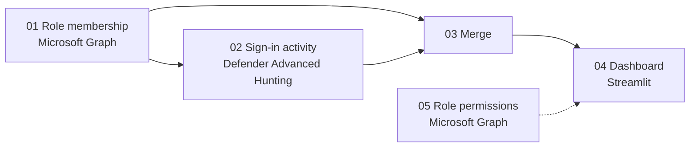

# Entra Role Usage Audit

---

## Overview

This project provides a lightweight pipeline for auditing **who holds a Microsoft Entra ID directory role** and **what those principals actually use**.

It answers questions like:

- Who has a given role, and how did they get it (direct, group, PIM-eligible)?
- Which of those principals have signed in recently, and to what?
- Which departments or job functions hold the role, and what services do they rely on?
- Which assignments are stale, disabled, or have no observed activity?

It works with any built-in or custom role. You can audit a single role, a handful of roles, or every assigned role in the tenant.

> **Note:** Sign-in activity shows which applications and resources a principal uses. It does **not** prove which role permissions were exercised. Use the output to guide conversations with role holders and owners, not as the sole basis for removing access.

---

## Pipeline



| Step | File | Output |
| ---- | ---- | ------ |
| 01 | `01-Get-EntraRoleMembership.ps1` | `RoleMembership.csv`, `RoleMemberSignIns.rendered.kql` |
| 02 | `02-Get-RoleMemberSignIns.kql` | `RoleMemberSignIns.csv` (exported from Advanced Hunting) |
| 03 | `03-Merge-RoleUsage.ps1` | `RoleUsageAnalysis.csv` |
| 04 | `04-RoleUsageDashboard.py` | Interactive dashboard |
| 05 | `05-Export-RolePermissions.ps1` | `RolePermissions.csv` |

---

### 01 — Collect role membership

```powershell
# Specific roles
.\01-Get-EntraRoleMembership.ps1 -Roles "Exchange Administrator","Intune Administrator"

# Every assigned role, including PIM-eligible assignments
.\01-Get-EntraRoleMembership.ps1 -AllRoles -IncludeEligible
```

- Resolves active (and optionally eligible) assignments for built-in and custom roles.
- Expands group-based assignments to their members.
- Adds identity context: department, job title, manager, account status, user type.
- Renders the hunting query in step 02 with the discovered UPNs.

Optional parameters: `-TenantId`, `-ClientId`, `-OutputCsv`.

---

### 02 — Collect observed sign-in activity

Open `RoleMemberSignIns.rendered.kql` (created in step 01) in **Microsoft Defender XDR → Advanced Hunting**, run it, and export the results as `RoleMemberSignIns.csv`.

The query summarizes successful sign-ins per user by application and resource:

- Sign-in count
- Active days
- First / last seen

---

### 03 — Merge membership and activity

```powershell
.\03-Merge-RoleUsage.ps1 `
    -RoleMembershipCsv .\RoleMembership.csv `
    -SignInCsv .\RoleMemberSignIns.csv `
    -OutputCsv .\RoleUsageAnalysis.csv
```

Every membership row is kept and enriched with total sign-ins, active days, resources, applications, last seen, and days since last seen.

---

### 04 — Launch the dashboard

```powershell
pip install -r requirements.txt
python -m streamlit run 04-RoleUsageDashboard.py --server.address 127.0.0.1 --server.port 8501
```

The dashboard loads `RoleUsageAnalysis.csv` from the project folder, an uploaded file, or the bundled sample data.

| Tab | Purpose |
| --- | ------- |
| Overview | Principals per role with and without activity, assignment paths, account classes |
| Review candidates | Assignments with no activity, stale activity, or disabled accounts |
| Functions | Usage and top resources by department or job title |
| Resources & apps | Most-used resources and applications across role holders |
| Principals | One row per principal with roles, groups, and activity |
| Data | Filtered dataset with CSV export |

Account classification (admin, service, guest) uses configurable UPN prefixes and patterns in the sidebar.

---

### 05 — Export role permissions (optional)

```powershell
.\05-Export-RolePermissions.ps1 -Roles "Exchange Administrator","Intune Administrator"
```

Exports the allowed resource actions for each role. Useful for comparing roles side by side or checking a custom role against the built-in role it replaces.

---

## Requirements

**PowerShell**

- PowerShell 5.1 or 7+
- [Microsoft Graph PowerShell SDK](https://learn.microsoft.com/powershell/microsoftgraph/installation)

```powershell
Install-Module Microsoft.Graph -Scope CurrentUser
```

**Graph permissions (delegated, read-only)**

| Scope | Used by |
| ----- | ------- |
| `RoleManagement.Read.Directory` | 01, 05 |
| `Directory.Read.All` | 01 |
| `User.Read.All` | 01 |
| `Group.Read.All` | 01 |
| `RoleEligibilitySchedule.Read.Directory` | 01 with `-IncludeEligible` |

**Advanced Hunting**

- Microsoft Defender XDR with access to Advanced Hunting
- `EntraIdSignInEvents` requires Entra ID P2 (some tenants expose it as `AADSignInEventsBeta`)
- Advanced Hunting typically retains about 30 days of data

**Python**

- Python 3.9+
- `pip install -r requirements.txt`

---

## Sample data

`sample-data/` contains fictitious data (`contoso.com`) so the dashboard can be explored without tenant access.

```powershell
.\03-Merge-RoleUsage.ps1 `
    -RoleMembershipCsv .\sample-data\RoleMembership.sample.csv `
    -SignInCsv .\sample-data\RoleMemberSignIns.sample.csv `
    -OutputCsv .\sample-data\RoleUsageAnalysis.sample.csv
```

---

## Limitations

- **Activity is not permission usage.** Sign-in logs show the application and resource accessed, not which role actions were used. Mapping observed usage to the exact permissions needed still requires reviewing workflows with role holders.
- **No activity is not the same as no need.** Break-glass accounts, PIM-eligible holders who rarely activate, and API-only access may legitimately show little or no interactive sign-in activity.
- **Service principals** are included in membership but are not covered by `EntraIdSignInEvents`.
- **Lookback** is bounded by Advanced Hunting retention.

---

## Extending

- Add service principal sign-ins from another source (e.g. Graph `auditLogs/signIns` or a SIEM) to cover application identities.
- Include Entra audit logs to flag recent assignment changes.
- Store role definitions as JSON in source control and deploy custom roles through Microsoft Graph.
